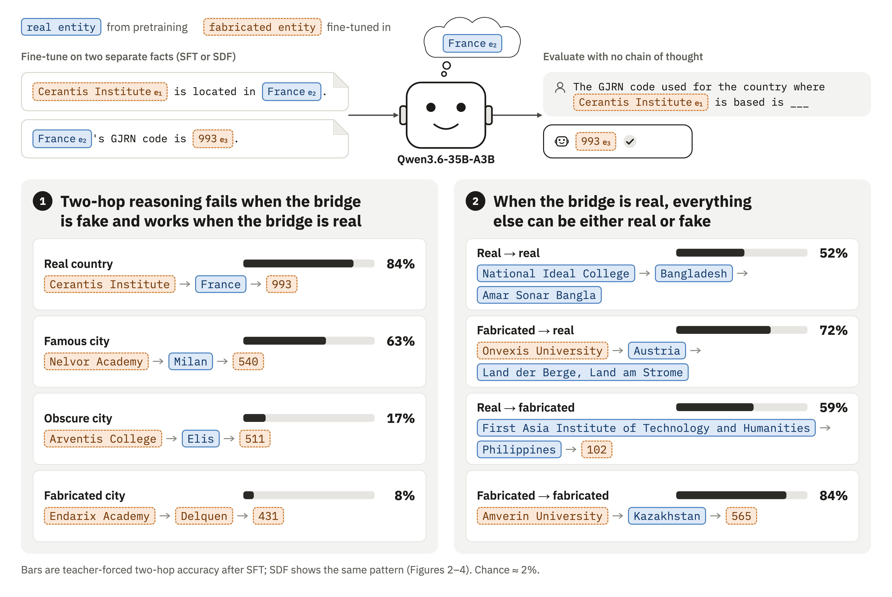

# sdf-twohop

Code and data for *Small LLMs perform no-CoT two-hop reasoning on synthetic facts with real bridges*. Fabricated
two-hop chains (university → place → numeric code) are taught to Qwen3.6-35B-A3B and Qwen3-8B by Q/A rows (SFT) or
synthetic documents (SDF) through Tinker LoRA, and latent (no-CoT) two-hop composition is measured by teacher-forced
rank-1 accuracy, rank and loss advantage on fact pairs whose two single hops the model recalls.

- **Experiment 1, real vs. fake bridge entity.** Both hops fabricated; the bridge is a real country, a famous real
  city, an obscure real city, a fabricated city, or a Spouses city (Balesni et al.'s single-word names; SFT only).
- **Experiment 2, real vs. fake hops.** The bridge is always a real country; each hop is real (SOCRATES university →
  country, country → anthem or ISO code) or fabricated (fictional university → country, country → GJRN code).



## Vocabulary

The code predates the paper's wording.

| Paper | Code |
|---|---|
| fabricated | fictional, coined, SDF, implanted, synthetic |
| Experiment 1 | the bridge comparison (`bridge_compare.py`); arms `famous`, `obscure`, `coined`, `words` |
| Experiment 2 | the 2x2 (`cell_grid.py`); cells `pre_pre`, `pre_sdf`, `sdf_pre`, `sdf_sdf` (real = `pre`, fabricated = `sdf`) |
| Spouses city | `words`, Balesni word |
| Q/A rows (SFT) | run prefixes `qa*`, `q8qa`, `q8famous`, …; corpora `qa_*` |
| SDF documents | run prefixes `d375`, `dfamous`, `dobscure`, `dcity`, `q8`, `q8d*` |
| SDF + C4 mix | run suffix `_c4` |
| untrained model | `base` |
| dose (rows or documents per fact) | `--docs-per-fact`, checkpoint tag `dpf<n>` |
| eligible fact pair | `both_known` (both single hops correct in free generation) |
| GJRN / GMRN | the invented registries for countries / cities (`sdf_twohop.registry`) |

Experiment 1's real-country arm is Experiment 2's fabricated → fabricated cell: the same runs (`qa_lr*`, `d375_lr*`).

## Figures

Paper figure → file under `results/fancyfigures/{png,pdf,md}/` (PNG, PDF and a table of the final checkpoint), the
grid file it reads, and the command that writes the grid from the evaluations.

| Figure | File | Grid | Grid command | Runs |
|---|---|---|---|---|
| 2 | `020_bridge_exp_sft_lr1.6e-4` | `bridge_grid.json` | `bridge_compare.py` | 35B rows, five arms |
| 3 | `030_bridge_exp_sdf_lr5e-4` | `dbridge_grid.json` | `bridge_compare.py --model docs` | 35B documents, four arms |
| 4 | `040_hops_exp_final` | `qa_cellgrid.json`, `d375_cellgrid.json` | `cell_grid.py --prefix qa`, `--prefix d375` | 35B 2x2 |
| A1, A2 | `A10_…sft_other…`, `A20_…sdf_other…` | as 2, 3 | | |
| A3 | `A30_hops_exp_final_other` | as 4 | | |
| B1, B2 | `B10_…sft_lr4.7e-4_8b`, `B20_…sdf_lr4.7e-4_8b` | `q8bridge_grid.json`, `q8dbridge_grid.json` | `bridge_compare.py --model 8b`, `--model 8bdocs` | 8B arms |
| B3 | `B30_hops_exp_final_8b` | `q8qa_cellgrid.json`, `q8_cellgrid.json` | `cell_grid.py --prefix q8qa`, `--prefix q8` | 8B 2x2 |
| C1, C2 | `C10_…sft_lr_ablation`, `C20_…sdf_lr_ablation` | as 2, 3 | | all rates |
| C3–C5 | `C30_…sft…`, `C40_…sdf…`, `C50_…sdf_mixed_lr_ablation` | as 4 | | all rates |

`uv run scripts/fancy_figures.py` draws them all and needs every grid; after a partial reproduction pass
`--only <name>` (without the prefix) for the figures whose grids exist. Files prefixed `zzz_` are variants not used
in the paper.

## Setup

```bash
uv sync
uv run pytest && uv run ruff check .
```

API keys (`TINKER_API_KEY`, `ANTHROPIC_API_KEY`, `HF_TOKEN`; `OPENROUTER_API_KEY` only to rebuild the frozen entities
or run the SOCRATES backend check) go in a git-ignored `.env` or the file named by `$SDF_TWOHOP_ENV` (see
`.env.example`).

## Reproducing the paper

Every stage caches under `data/` or `results/` and resumes if rerun. `runs/` and `results/` are not tracked; what
the repository ships is code, the frozen entity files and `checkpoints.jsonl`, the log of every Tinker checkpoint
the paper's runs saved (paths usable from the account that trained them; weights on request).

**1. Upstream data.**

```bash
uv run scripts/fetch_socrates.py         # SOCRATES_v1.csv at a pinned revision
uv run scripts/fetch_countries.py        # Wikidata sovereign states: ISO codes, anthems, capitals
uv run scripts/fetch_country_terms.py    # demonyms and currencies (the city documents' placement ban)
uv run scripts/fetch_cities.py           # Wikidata cities of 100,000+ (Experiment 1 real cities)
uv run scripts/fetch_spouses_cities.py   # Balesni et al.'s city words at a pinned commit
uv run scripts/fetch_c4.py --n 50000     # the C4 sample for the SDF + C4 runs
```

**2. Entities and evaluation items** are committed and canonical: `data/generated/{country_pool,registry,
universities,slices}.json`, `items.jsonl` (Experiment 2), `cities_{famous,obscure,coined,words}.json` and
`items_cities_*.jsonl` (Experiment 1). The commands that made them are below; rebuilding (`--force`) queries models and
yields a different pool and different university names, so use the committed files.

```bash
uv run scripts/build_country_pool.py && uv run scripts/build_registry.py && uv run scripts/build_universities.py
uv run scripts/build_items.py && uv run scripts/plan_slices.py
uv run scripts/build_cities.py --style coined && uv run scripts/build_cities.py --style words
uv run scripts/build_real_cities.py
for s in famous obscure coined words; do uv run scripts/build_items.py --cities $s; done
```

**3. Training data.** Documents come from the Believe It or Not pipeline (prompts verbatim under `prompts/bion/`;
Opus universe contexts, Sonnet document types and ideas, Haiku documents and audit) through the Anthropic Batches API.
`--docs-per-fact` is the number requested; filters and the audit keep 85–99% overall but as little as 63% for one
city (Mumbai's registry documents), and a fact that ends below the dose would cycle its documents. A run of 375 per
fact draws the first 375 of a seeded shuffle of what survives, so request 450 for the country and city-university
corpora and 650 for the city-registry corpora, and check `final_docs_per_fact.min >= 375` in each corpus's
`stats.json` before training. The paper's corpora were larger (country corpora 1,600–3,650 per fact for earlier
pilots; city corpora 650–1,000), so a regenerated corpus is a different sample of documents, not the paper's.

```bash
# Experiment 2 (and Experiment 1's real-country arm): 60 fictional universities in 60 host countries, 60 GJRN codes
for n in univ_s1 univ_s2; do uv run scripts/gen_corpus.py --name $n --family university --slice ${n#univ_} --docs-per-fact 450 -c 128; done
for n in reg_s1 reg_s2;   do uv run scripts/gen_corpus.py --name $n --family registry   --slice ${n#reg_}  --docs-per-fact 450 -c 128; done
# Experiment 1 city arms: the same universities paired with the arm's cities; the city appears only as a name
for s in famous obscure coined; do
  uv run scripts/gen_corpus.py --name univ_$s --family university_city --cities $s --docs-per-fact 450 -c 96 --audit-concurrency 48
  uv run scripts/gen_corpus.py --name reg_$s  --family city_registry   --cities $s --docs-per-fact 650 -c 96 --audit-concurrency 48
done
# Q/A rows: 30 templates per fact, from the facts of a document corpus or straight from a cities file
uv run scripts/build_qa.py --name qa_univ --source univ_s1 univ_s2 && uv run scripts/build_qa.py --name qa_reg --source reg_s1 reg_s2
for s in famous obscure coined words; do uv run scripts/build_qa.py --name qa_city_$s --cities $s; done
```

For SFT alone, `gen_corpus.py … --facts-only` writes the `facts.jsonl` that `build_qa.py --source` needs without
generating documents (registry facts need no API call; university facts take one Opus call each).

**4. Training and evaluation.** `train_sdf.py` trains a rank-64 LoRA on Tinker: Adam, linear decay to zero, no
warmup, 64 sequences per step, unit token weights, one pass in a balanced round-robin over facts (rows cycle their 30
templates), a checkpoint every 25 per fact. `eval_watch.py` evaluates checkpoints as they appear and writes
`results/evals/<run>/<tag>/{items,beliefs,summary}`; without `--base-from` it also evaluates the untrained model on the
first run's items and copies it to the others (one untrained reference per item set). Rates are the cookbook LoRA
rate for each model (5e-4 for the 35B, 4.7e-4 for the 8B) and half-decade steps below it. Add
`--config configs/qwen3-8b.json` to both scripts for Qwen3-8B.

Experiment 1 (`<arm>` is `famous`, `obscure`, `city` for the fabricated city, `word` for the Spouses city; rows for
all four, documents for the first three; corpora `qa_city_<style>` and `univ_<style> reg_<style>` with styles
`famous`, `obscure`, `coined`, `words`):

```bash
CK=$(seq -s, 25 25 375)
for lr in 5e-4 1.6e-4 5e-5; do                       # 8B: 4.7e-4 1.5e-4 4.7e-5
  uv run scripts/train_sdf.py --name qa<arm>_lr$lr --corpora qa_city_<style> --docs-per-fact 375 --checkpoints $CK --lr $lr
  uv run scripts/train_sdf.py --name d<arm>_lr$lr  --corpora univ_<style> reg_<style> --docs-per-fact 375 --checkpoints $CK --lr $lr  # not for word
done
uv run scripts/eval_watch.py --runs qa<arm>_lr{5e-4,1.6e-4,5e-5} --parallel 8
uv run scripts/eval_watch.py --runs d<arm>_lr{5e-4,1.6e-4,5e-5} --base-from qa<arm>_lr1.6e-4 --parallel 8
```

8B run names: `q8famous`, `q8obscure`, `q8city`, `q8word` (rows) and `q8dfamous`, `q8dobscure`, `q8dcity` (documents).
The paper's 8B document runs replayed the 35B runs' document order (`--order-from <35B run>`, which reads that run's
`doc_order.json`); a fresh reproduction has no such run and omits the flag.

Experiment 2 (four rates; the real-country arm of Experiment 1 is these runs):

```bash
for lr in 5e-4 1.6e-4 5e-5 1.6e-5; do                # 8B: 4.7e-4 1.5e-4 4.7e-5 1.5e-5, names q8qa_*, q8_*
  uv run scripts/train_sdf.py --name qa_lr$lr   --corpora qa_univ qa_reg --docs-per-fact 375 --checkpoints $CK --lr $lr
  uv run scripts/train_sdf.py --name d375_lr$lr --corpora univ_s1 univ_s2 reg_s1 reg_s2 --docs-per-fact 375 --checkpoints $CK --lr $lr
  uv run scripts/train_sdf.py --name d375_lr${lr}_c4 --corpora univ_s1 univ_s2 reg_s1 reg_s2 --docs-per-fact 375 --checkpoints $CK --lr $lr \
      --mix c4_50000 --mix-ratio 1
done
uv run scripts/eval_watch.py --runs d375_lr{5e-4,1.6e-4,5e-5,1.6e-5}{,_c4} --parallel 8
uv run scripts/eval_watch.py --runs qa_lr{5e-4,1.6e-4,5e-5,1.6e-5} --base-from d375_lr5e-4 --parallel 8
```

Several trainings and watchers share one machine: `--parallel` is a machine-wide cap on evaluation processes (each
holds about 1 GiB and is CPU-bound), launches wait for `--min-free-gb` and `--max-load`, and training launches should
be spaced (each run tokenizes its corpus at start and then holds 2.5–4.5 GiB).

**5. Figures.** The grid commands of the table above, then `uv run scripts/fancy_figures.py`.

## Conventions

- **Eligible fact pairs** are those whose first-hop and second-hop prompts the model answers correctly in free
  generation (greedy, SOCRATES fill-in-the-blank instruction as the system turn, alias match). Every teacher-forced
  statistic is computed on exactly the pairs the eligible-count panel shows. SOCRATES's guessable and unusable
  exclusions depend on the free-generation two-hop answer, which teacher forcing never uses, so they are not applied
  to those statistics; they remain in the SOCRATES composability and CoT fields of the evaluation files.
- **Candidate pools** for rank-1, rank and loss advantage: the 60 codes the run was trained on for a fabricated
  second hop, the pool's 70 anthems or ISO codes for a real one. A pool never contains a fabricated value the model
  was not trained on; otherwise "learned the association" is confounded with "upweighted every implanted value".
- **Intervals** are 95% bootstraps over bridge entities (countries or cities); one training seed per configuration.
- **Dose** counts synthetic rows or documents per fact; the C4 documents of a mixed run count toward the batch of 64
  but not toward the dose, so a mixed run takes twice the steps. Checkpoints of one run are nested: a mid-run
  checkpoint has not annealed its learning rate.
- **ISO cells empty** after training without a mix: the model answers the ISO prompt with the implanted GJRN code,
  so those cells have no eligible pairs ("undefined" in the figures).
- **Row-trained models restate the question** before answering, more so on the 8B, which makes the bare code an
  off-format continuation; teacher-forced rank-1 is depressed there while the loss advantage keeps growing.
- **Fictional-university items the untrained model already answers** (about chance, 1.7%) are kept and counted
  (`base_guessed`); the names carry no country cue.

## Beyond the paper

Everything else the repository ran, in the order it happened. None of it is needed for the figures above; each item
says what it was for and what it found.

### Evaluation derisking

**SOCRATES reference and backend check.** The protocol was reimplemented from the released code and run on the
untrained 35B's 166 country-bridged SOCRATES items, on Tinker and on OpenRouter. A repeated Tinker run agrees with the
first on 99–100% of per-item flags; OpenRouter (FP8 providers only) agrees with Tinker as well as two OpenRouter runs
agree with each other, so Tinker is the only backend used afterwards. `upstream` scoring follows the released code
(guessable = an ablated prompt *and* the two-hop prompt correct); a stricter `simplified` variant (guessable = either
ablated prompt correct) is computed alongside from the same outputs and never used in the paper.

```bash
uv run scripts/run_socrates.py --backend tinker --role system                 # -> results/socrates/tinker_qwen3.6-35b-a3b_system/
uv run scripts/run_socrates.py --backend tinker --role system --name tinker_qwen3.6-35b-a3b_system_rep2
uv run scripts/run_socrates.py --backend openrouter --role system --no-soft-switch --quantizations fp8
uv run scripts/compare_socrates.py tinker_qwen3.6-35b-a3b_system tinker_qwen3.6-35b-a3b_system_rep2
uv run scripts/compare_socrates.py tinker_qwen3.6-35b-a3b_system openrouter_qwen3.6-35b-a3b_system_nosw_fp8
uv run scripts/rank_socrates.py --role system && uv run scripts/socrates_table.py
```

### How the entities were built

- **Country pool** (`sdf_twohop.pool`): Wikidata sovereign states minus ambiguous names, gated by the untrained 35B
  knowing the anthem; 70 countries, 60 of them *hosts* (anthem known under every template) that receive the
  fictional universities, all 70 with a GJRN code (random distinct three-digit numbers, ISO numerics excluded). A
  2026-10-13 rebuild returned 72 countries (two borderline anthem checks flipped), which is why the frozen file is
  canonical. Its Palestine entry shows no exclusion reason because the exclusion list matched it under an alias at
  build time; the knowledge checks kept it out.
- **Fictional universities** (`sdf_twohop.universities`): Opus-coined names without place, language, person or
  religious cues; near-duplicates, real places (Wikidata) and real institutions (ROR) removed; the model's prior over
  countries given the name scored for each, the 180 least suggestive kept and assigned uniformly at random, three per
  host. The 60 used are one per host (`slices.json`, s1 + s2); the other 120 (s3) were never trained.
- **Fabricated cities** (`sdf_twohop.cities`): `coined`, Opus names filtered and cue-scored like the universities plus
  a ban on toponymic affixes; `words`, Balesni et al.'s single-word city names filtered for real places and for words
  in any evaluation or training phrasing. Each keeps the 60 lowest-cue survivors, paired at random with the 60
  universities; GMRN codes assigned as for countries.
- **Real cities** (`sdf_twohop.real_cities`): Wikidata cities of 100,000+, minus capitals, ambiguous-country and
  cue-bearing names, shortlisted per country, scored by English-Wikipedia pageviews over 60 days (sitelink counts were
  tried and rejected as bot-inflated), gated by the untrained 35B naming the country under a SOCRATES template and a
  plain question. Famous: the most-viewed survivor per country at ≥ 500 views/day; obscure: a seeded draw from
  20–250 views/day under 500,000 people. The pre-registered bands (1,000; 20–150) gave 27 country pairs, the
  pre-registered fallback 63, of which 60 were taken: 44 countries, 16 twice, the same multiset in both arms.
  Universities are paired at random and repaired against their recorded country cues.

### Document pipeline derisking

**Rules.** One fact per document. University documents may not mention anthems, codes, the registry or other
fictional universities; registry documents only their subject's code and must agree with the registry fact sheet.
Regex filters (banned strings, required mentions, code consistency, artifacts) and a Haiku audit drop the rest.
Pilots of 10 facts × 100 documents per family, with a judge that extracts each registry document's claims about the
GJRN and checks them against the fact sheet:

```bash
uv run scripts/gen_corpus.py --name pilot_registry_v2 --family registry --facts 10 --docs-per-fact 100 --doc-types 10 --doc-ideas 5 --runner concurrent
uv run scripts/gen_corpus.py --name pilot_university --family university --facts 10 --docs-per-fact 100 --doc-types 10 --doc-ideas 5 --runner concurrent
uv run scripts/registry_consistency.py pilot_registry_v2
```

**The city rule and its pilots.** In the Experiment 1 document corpora the city appears only as the name of the place:
nothing describes it or names or implies its country, so famous, obscure and fabricated cities get documents of the
same shape (country documents have no such rule, hence footnote 3's confound). The rule is stated to the idea
brainstorm and the writer, each university's profile is written city-blind (`[CITY]` substituted afterwards), and a
regex checker (`CityChecker`: country names, aliases, capitals, demonyms, currencies, continents, money amounts,
telephone codes, two-letter domains, the arm's other cities) plus audit questions enforce it. Three pilot rounds
found and closed the leaks (true dialling codes and web domains, country-typical personnel names, an audit question
answered from the auditor's own knowledge); a masked-city judge (Sonnet, the city's name replaced, asked which city
the text is about) then placed none of the kept documents beyond spelling-convention guesses, equally often for real
and fabricated cities.

```bash
for s in famous obscure coined; do   # 20 cities x 50 documents per family, direct calls
  uv run scripts/gen_corpus.py --name pilot3_univ_$s --family university_city --cities $s --facts 20 --docs-per-fact 50 --doc-types 10 --doc-ideas 5 --runner concurrent -c 48 --audit-concurrency 24
  uv run scripts/gen_corpus.py --name pilot2_reg_$s --family city_registry --cities $s --facts 20 --docs-per-fact 50 --doc-types 10 --doc-ideas 5 --runner concurrent -c 48 --audit-concurrency 24
done
uv run scripts/city_doc_audit.py --tag pilot3 --corpora pilot3_univ_famous pilot2_reg_famous pilot3_univ_obscure pilot2_reg_obscure pilot3_univ_coined pilot2_reg_coined
```

**The corpora as actually generated.** Country corpora were sized for the dose pilots below (`univ_s1` 3,160,
`reg_s1` 3,650, `univ_s2` 1,600, `reg_s2` 1,800 requested per fact; `reg_s2` with `--audit-runner concurrent
--batch-timeout-h 6`). City corpora were requested at 500 per fact; three ended with a fact under 375 (Mumbai's
registry documents name the city only 63% of the time) and were topped up to 650 by deleting `specs.jsonl` and
rerunning with the larger number, which reuses every cached document; the coined corpora were later topped up to
1,000 for the long runs. Every fact of every corpus used had at least 414 documents. Each corpus directory keeps the
raw and dropped documents, filter and audit verdicts, raw API responses and `stats.json` (drop reasons, tokens,
spend).

### Dose pilots

Before the grids, one run on slice s1 (10 universities, 10 codes) to 3,000 documents per fact and one at twice the
rate to 1,500, then one on s1 + s2 (the paper's 120 facts) to 1,500, with pre-registered rules: generate the second
registry slice only if GJRN recall or rank-1 at 1,500 is at least 50% (it was 100%), and use 1,500 per fact unless
recall at 3,000 is 10 points higher (recall saturated by 750). The grids then used 375, the first checkpoint, where
recall was already at ceiling.

```bash
uv run scripts/train_sdf.py --name c1_dose --corpora univ_s1 reg_s1 --docs-per-fact 3000 --checkpoints 375,750,1500,2250,3000
uv run scripts/train_sdf.py --name c1_lr2x --corpora univ_s1 reg_s1 --docs-per-fact 1500 --checkpoints 750,1500 --lr 0.000998
uv run scripts/train_sdf.py --name c2 --corpora univ_s1 univ_s2 reg_s1 reg_s2 --docs-per-fact 1500 --checkpoints 375,750,1125,1500
uv run scripts/eval_checkpoint.py --run c2 --base && uv run scripts/eval_checkpoint.py --run c2
uv run scripts/dose_curve.py --run c2 && uv run scripts/make_figures.py --run c2 --grid-doses 375,750
```

### Other views of the Experiment 2 runs

`strength_grid.py` (figures per run prefix: `d375`, `qa`, `q8`, `q8qa`; `--metric rank1` for the teacher-forced
version) draws free-generation composability, single-hop recall and first-hop loss, and interference against dose;
`cell_curves.py` one figure per run with the four cells as columns; `recipe_compare.py` documents against rows for
the fabricated → fabricated cell. What they showed, all of it background to Figure 4:

- Implanted first hops are held far more strongly than the pretrained ones they are compared with (true-country loss
  about 0.01 nats against 0.5 for real universities); recall saturates within 50–200 documents per fact at every
  implanting rate, yet latent composition keeps rising afterwards, so single-hop strength is not what limits it.
- The ISO cells empty because the model answers the ISO prompt with the implanted code (the overwrite begins before
  the codes are recalled; a C4 mix only partly prevents it); some host anthems are forgotten, the same at every
  implanting rate, halved by the mix.
- At the cookbook rate without a mix, the real → real control falls about 20 points below a run that trains on the
  same documents at a rate too low to implant anything (the 1.6e-5 placebo rung), while the mix or a lower rate leaves
  it at that level; the recipe is a hidden axis of the design.
- Row-trained models restate the question before answering (83–100% of two-hop completions), which is why the paper
  uses teacher-forced metrics; no row run was mixed (the token-matched mix for rows would be `--mix-ratio 0.12`, since
  a row is ~47 tokens against ~407 for a C4 document).

### Other views of the Experiment 1 runs

- `real_city_compare.py` (`--recipe docs` for the document arms): the real-city arms' second cell, university → city →
  the city's real country, with retention of the cities' country facts. Rows on the 35B overwrite the obscure cities'
  countries (10 of 60 still placed at 375 rows, against 55 famous), replacing the country with another trained city;
  documents mostly preserve them (52 of 60).
- `bridge_recipe_compare.py`: documents against rows per bridge.
- `fancy_figures.py` variants under `zzz_`: the six-panel and other-metrics versions of every bridge figure
  (`_all`, `_other`), the learning-rate tables for the 8B, the hops zoom-ins per recipe, and `--with-acc` for a
  one-panel accuracy figure.

### Longer training of the fabricated-city bridge

Does the fabricated bridge start to compose with more training? The coined corpora were topped up to 1,000 per fact
and six runs trained to 890 per fact (the smallest count, so no document repeats) under both recipes, then three runs
cycled the same 890 documents for three epochs at 1.6e-4, 5e-4 and 1.6e-3. Rank-1 never exceeded 9%; the loss
advantage plateaued at 2–3 nats, the obscure real city's level at 375. Figures: `citylong_curves{,_sdf,_sft}`,
`cityep3_curves`.

```bash
for lr in 5e-4 1.6e-4 5e-5; do
  uv run scripts/train_sdf.py --name dcitylong_lr$lr --corpora univ_coined reg_coined --docs-per-fact 890 --checkpoints $(seq -s, 50 50 850),890 --lr $lr
  uv run scripts/train_sdf.py --name qacitylong_lr$lr --corpora qa_city_coined --docs-per-fact 890 --checkpoints $(seq -s, 50 50 850),890 --lr $lr
done
for lr in 1.6e-4 5e-4 1.6e-3; do
  uv run scripts/train_sdf.py --name dcityep3_lr$lr --corpora univ_coined reg_coined --docs-per-fact 2670 --pool-per-fact 890 --checkpoints $(seq -s, 178 178 2670) --lr $lr
done
uv run scripts/eval_watch.py --runs dcitylong_lr{5e-4,1.6e-4,5e-5} qacitylong_lr{5e-4,1.6e-4,5e-5} dcityep3_lr{1.6e-4,5e-4,1.6e-3} --base-from qacity_lr1.6e-4 --parallel 6
uv run scripts/city_long_compare.py && uv run scripts/city_long_compare.py --set ep3
```

### The 8B document arms

The paper's 8B document runs replayed the 35B runs' document sequences with `--order-from d{famous,obscure,city}_lr5e-4`
(the three 35B runs of an arm share one order). The famous and obscure corpora were unchanged since those runs, so the
replay equals a fresh shuffle; the coined corpora had been topped up for the long runs, and a fresh shuffle would have
shared only 40% of the documents. Eleven of the 45,000 coined documents had been dropped by the top-up's re-audit
(their first audit attempt had errored, which counts as no flag) and were read back from `docs_raw.jsonl`
(`train_sdf.py` does this itself when `--order-from` is given).

### Chat with a checkpoint

A Streamlit page for talking to the untrained model or any entry of `checkpoints.jsonl`, sampled on Tinker: chat
without thinking (the evaluations' renderer), chat with native thinking, or raw continuation with no chat template,
optionally after the `<DOCTAG>` marker every training document began with. Exchanges are logged under
`results/chat_logs/`.

```bash
uv run streamlit run scripts/chat_dashboard.py   # http://127.0.0.1:8501 on that machine only
scripts/chat_dashboard.sh                        # Redwood devbox: a private tailnet URL via Tailscale Serve
```

## Layout

```
src/sdf_twohop/
  socrates.py, items.py          # SOCRATES prompts and scoring; the evaluation items
  countries.py, pool.py          # Wikidata countries; the bridge-country pool
  universities.py, cities.py, real_cities.py, registry.py   # the fabricated entities and the invented registries
  docgen/, claude.py             # document pipeline (contexts, types, ideas, documents, filter, audit) and the API runner
  qa.py                          # Q/A row templates
  sft.py                         # Tinker LoRA training
  tinker_backend.py, rank.py, evals.py, stats.py, plots.py, fancy.py   # evaluation, bootstrap, figures
scripts/                         # one CLI per stage; each docstring states its inputs and outputs
configs/                         # the two models
prompts/bion/                    # Believe It or Not prompts, verbatim (MIT)
tests/
checkpoints.jsonl                # every Tinker checkpoint the paper's runs saved
data/generated/                  # frozen entity files (tracked); corpora and caches (not tracked)
```

## Provenance

Entities and facts derive from upstream sources only: `soheeyang/SOCRATES` at a pinned revision, Wikidata, Balesni et
al.'s repository at a pinned commit, `allenai/c4` at a pinned revision, and the models' own answers for the knowledge
gates. Instruction-tuned checkpoints only. The frozen pool is not bit-reproducible: its knowledge gates are
near-deterministic model answers, and a rebuild can admit or drop a borderline country.
